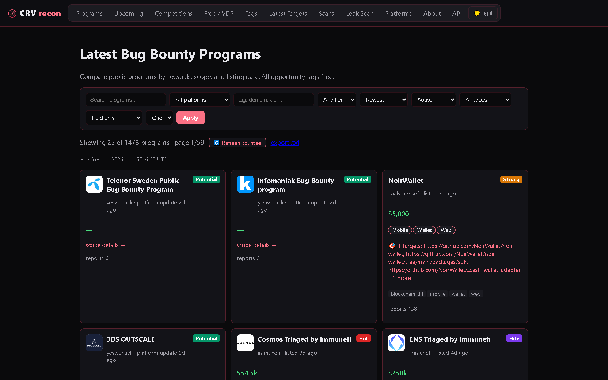
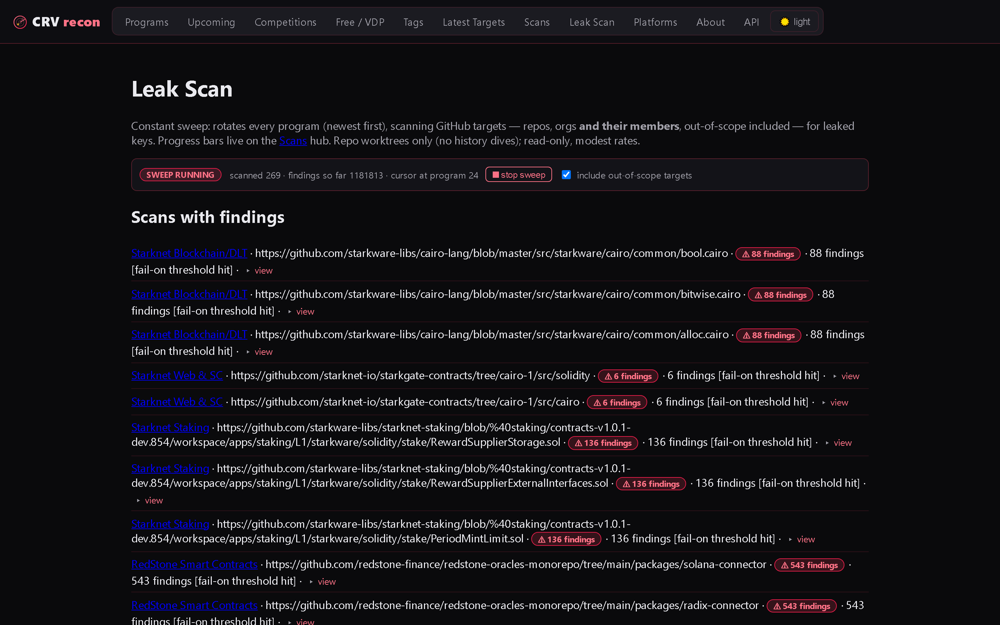
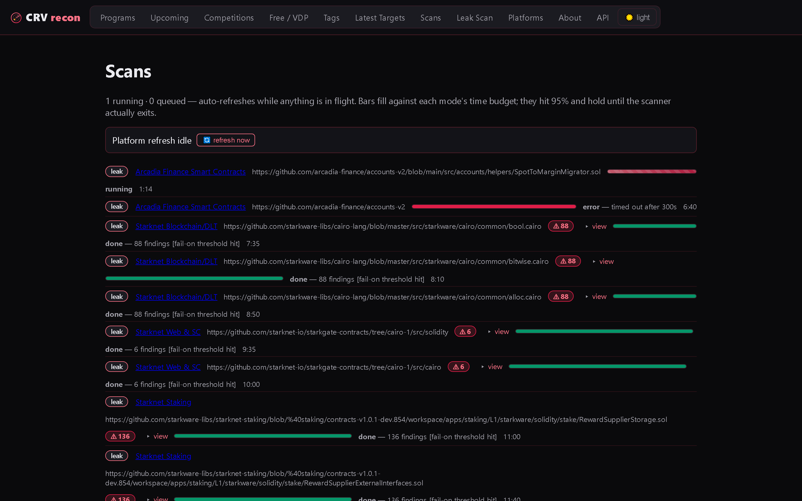
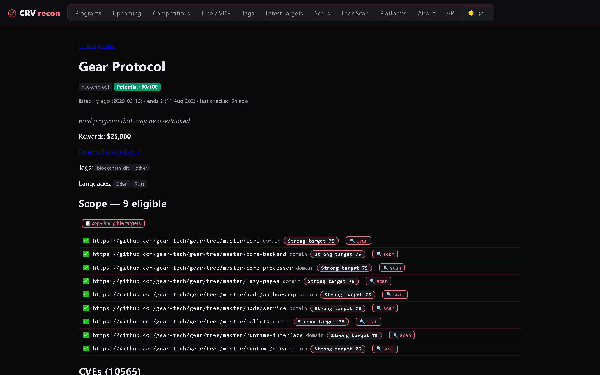
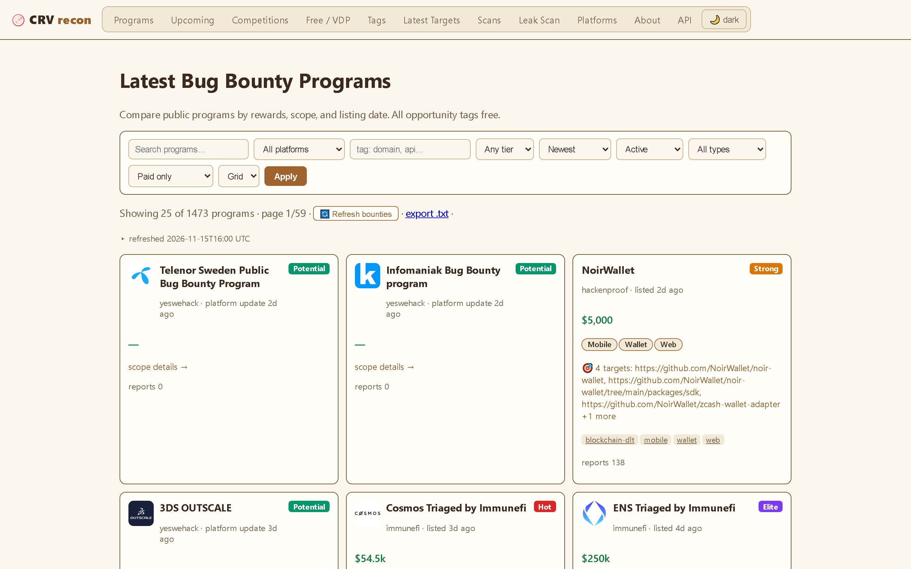

# CRV recon

**A free, self-hosted bug-bounty program radar — with a constant GitHub leak sweep.**

CRV recon aggregates public bug-bounty programs from 11 upstream platforms
(HackerOne, Bugcrowd, Immunefi, HackenProof, YesWeHack, Sherlock, Cantina,
Code4rena, CodeHawks, Intigriti and an aggregator lane that fills 15 more),
scores them for opportunity, diffs scope changes between refreshes, runs CVE
sweeps against targets — and continuously rotates every program's GitHub
surface through a leak scanner, looking for keys the devs forgot existed.

| | |
|---|---|
|  |  |
|  |  |

Light mode too — cream and brown, because dark mode shouldn't get all the fun:



## What's inside

- **Program directory** — 1,400+ live programs with rewards, tags, languages,
  scope trees, listing dates; searchable and filterable, all scoring tiers free
- **Scope-change tracking** — every refresh diffs targets against the previous
  snapshot; new/removed/changed scope shows up on the program page
- **Opportunity scoring** — Elite/Hot/Strong/Potential tiers computed from
  rewards, recency, platform and program shape
- **CVE sweeps** — per-target CVE lookup merging a local cvelistV5 /
  advisory-database index with the GitHub Advisory API and code search
- **Constant leak sweep** — a background daemon rotates every program
  (newest first) through repo-mode secret scans. GitHub-shaped targets only:
  repos, orgs *and their members*, out-of-scope targets included — because
  leaked keys live wherever devs push them, not inside program scope
- **Key liveness ladder** — eth keys found in the wild get their wallet
  address derived **offline**, then balance + nonce checked on a public RPC:
  `FUNDED` / `HISTORY` / `EMPTY` / `UNVERIFIED`. The key itself is never used
- **Progress bars + scan hub** — honest elapsed-vs-budget bars for every scan,
  live hub with running/queued counters
- **Two themes** — dark (black + red-pink) and light (cream + brown)
- **JSON API** — every page has a matching endpoint; see `/api`

## Quick start

```bash
pip install -r requirements.txt
python refresh.py            # seed the DB with offline samples (works offline)
python app.py                # serve on http://127.0.0.1:5000
```

That's the whole loop. The UI is fully usable on seed data before a single
live request.

### Going live

```bash
python refresh.py --live     # pull real programs from all upstream platforms
python app.py --live         # + re-scrape in the background every 30 min
```

- The three JS-heavy platforms (Immunefi, Cantina, bbradar.io) use a browser
  lane: `pip install playwright && playwright install chromium` enables them.
  Everything else works without it.
- Set `GITHUB_TOKEN` (env) before running CVE sweeps or leak scans — GitHub
  API lanes are rate-limited hard without one.

### Optional: local CVE index (recommended)

The CVE sweep falls back to the GitHub Advisory API + code search with no
local index, but building the index gets you the *complete* cvelistV5 corpus
(all ~425k CVE records) queried instantly, offline:

```bash
python cvecorpus.py          # clones public corpora (cvelistV5, advisory
                             # database, exploitdb) + builds data/cve_v5.db
```

First run clones the public corpora (a few GB, takes a while); later runs
increment. Point it at an existing checkout with `CVE_VAULT_DB` if you have
one.

### Optional: leak scanning

The leak sweep shells out to
[`crv-leak-scan`](https://github.com/colby999/crv-leak-scan) — a TypeScript
secret scanner with 37 built-in detectors, entropy floors, line-scoped
negative-context gates and a 250-check test suite:

```bash
git clone https://github.com/colby999/crv-leak-scan
cd crv-leak-scan && npm install && npm run build
echo /path/to/crv-leak-scan/dist/cli.js > scanner_path.txt   # next to app.py
```

Without it, everything else still works — the scan buttons just report
"no scanner found". The scanner auto-detects in common locations too.

### The leak sweep, precisely

- Read-only: public repos are cloned shallow, worktree scanned, no history
  dives, modest rates, nothing is ever authenticated against
- One scan at a time, newest program first, wrapping for full coverage
- Findings land in the DB with severity + TRIAGE scores; raw secrets are
  stored locally but render **blurred** in the UI (click to unblur)
- Eth-key findings run the offline-derivation + public-RPC liveness ladder
  described above; API-key findings are deliberately never auto-verified
  (that would mean using the credential — that's a human decision)

## Tests

```bash
python tests/verify.py       # prints METRIC checks_passed=N (offline)
```

The suite covers scrapers (from saved fixtures), scoring, tracking, CVE
parsing, the liveness verdict mapping, migrations and every UI lane.

## Layout

```
app.py            Flask app + routes + in-process scheduler
scrapers/         one adapter per upstream platform (+ browser lane)
tracker.py        refresh diffing: scope changes, new/removed targets
opportunity.py    scoring tiers
cvecorpus.py      public-corpus downloader + local CVE index builder
leaksweep.py      the constant sweep daemon
keyliveness.py    offline address derivation + public-RPC verdicts
scanhook.py       scanner integration (auto-detect + invocation)
db.py, schema.sql SQLite layer + migrations
tests/            verify.py suite + upstream fixtures
```

## Notes

- Keep it bound to localhost; it's a research tool, not a hardened service
- Respect each upstream platform's terms when scraping; modest rates only
- Find & report only — never authenticate to a target with a found key
  unless that program's rules explicitly allow it

## License

MIT — see [LICENSE](LICENSE).
